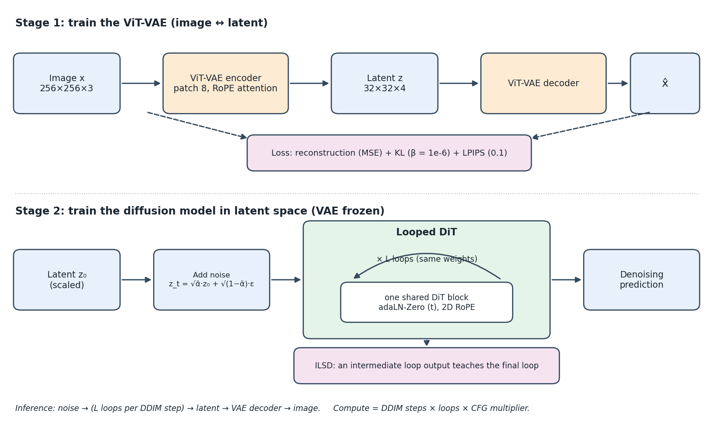
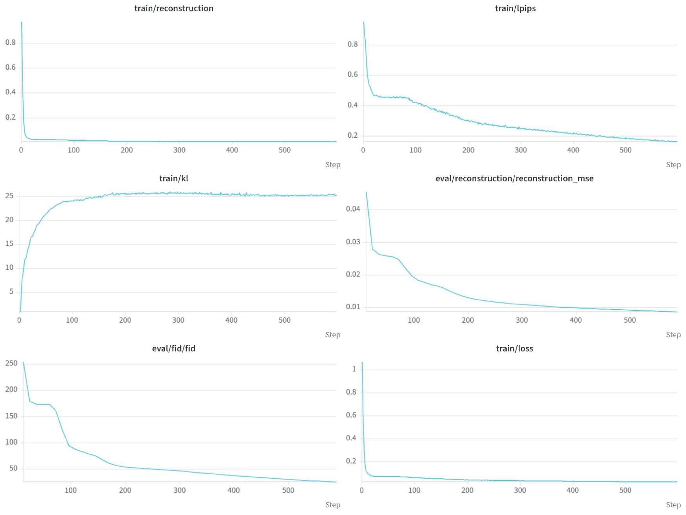
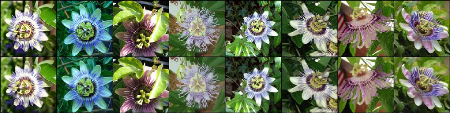
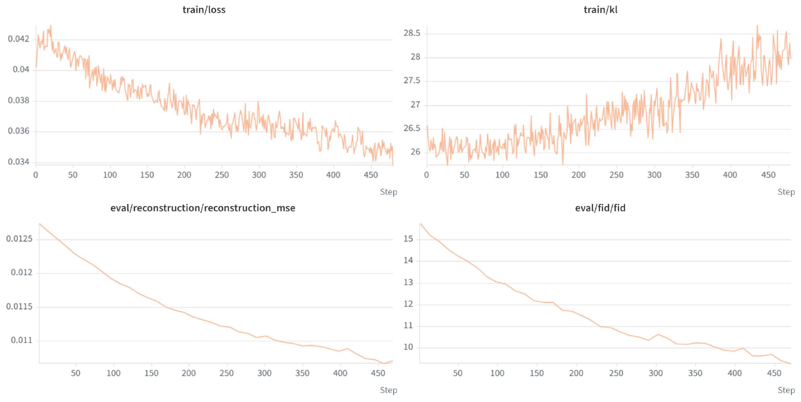
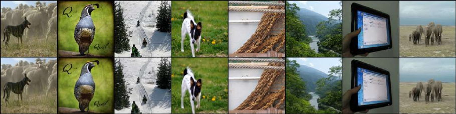
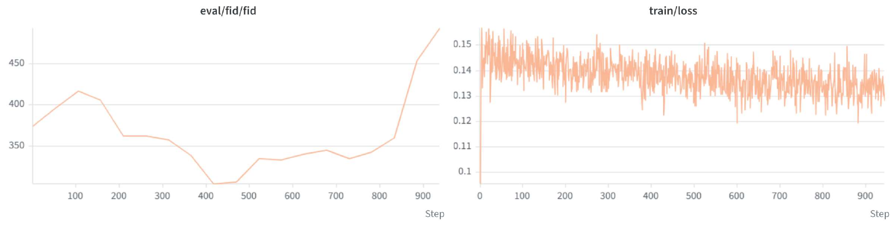
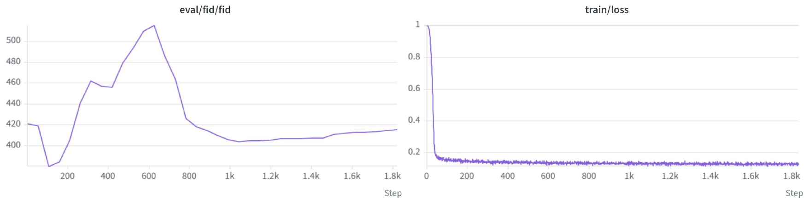
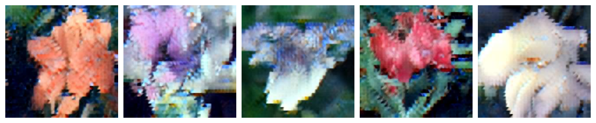
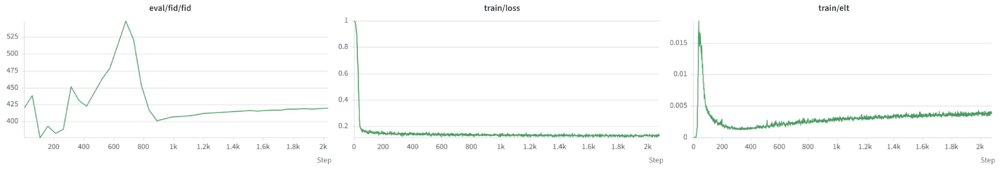
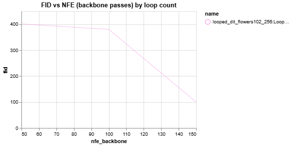

# SC-ELT: Elastic Looped Transformer for Latent Diffusion

A from-scratch PyTorch implementation of a two-stage latent diffusion pipeline (**ViT-VAE → looped DiT**) built to study **Elastic Looped Transformers (ELT)** and **inter-loop self-distillation (ILSD)**: image generation where inference compute is a dial you can turn without retraining.

> Developed during a research internship at **Telcotec** (July 1 – August 28, 2026) within the **Research Labs Sup'Com (RLS)** organization.
> The ELT architecture comes from [*Elastic Looped Transformer* (arXiv:2604.09168)](https://arxiv.org/abs/2604.09168). This repository is an independent reimplementation, not the authors' code.

**Contents:** [Summary](#summary) · [Pipeline](#pipeline) · [Method](#method) · [Implementation status](#implementation-status) · [Experimental setup](#experimental-setup) · [Results](#results) · [Limitations and open issues](#limitations-and-open-issues) · [Reproducing the experiments](#reproducing-the-experiments) · [Repository structure](#repository-structure) · [Engineering notes](#engineering-notes) · [Future work](#future-work) · [References](#references)

---

## Summary

- **Full pipeline from scratch:** RoPE ViT-VAE, DiT-B with adaLN-Zero and 2D RoPE, Looped-DiT, DDIM sampling, FID evaluation, W&B tracking.
- **Compute as a dial:** the looped model reuses one shared backbone for `loop_steps` iterations, so the number of loops can be changed at inference time.
- **Matched comparison:** three variants share one codebase and one set of hyper-parameters: DiT-B, Looped-DiT-B (no distillation) and ELT (Looped-DiT-B + ILSD).
- **Observed trend:** on one ELT checkpoint, FID fell from ≈400 to ≈100 as backbone passes grew from 50 to 150 (3 loop counts). See [open issues](#limitations-and-open-issues) before drawing conclusions from it.
- **What is not shown:** ILSD's own contribution. The non-distilled ablation was not swept, and early FID curves of ELT and the ablation overlap.

> **Scope.** All generative experiments use **Oxford Flowers-102 (256×256)**. The plan was to start on a small dataset and move to an ImageNet subset only if the baseline worked. Time and compute (one shared A40) did not allow ImageNet diffusion training, so it is left for [future work](#future-work). FID values are computed on 1,000 generated images and are indicative only.

---

## Pipeline



*Two-stage latent diffusion: a ViT-VAE maps images to a 32×32×4 latent, then a looped DiT is trained to denoise in that latent space. Framing follows Dieleman, [Generative modelling in latent space](https://sander.ai/2025/04/15/latents.html); the diagram was drawn for this project.*

| Variant | Model name in config | Description |
|---|---|---|
| **DiT-B** | `dit` | Conventional non-looped baseline (12 blocks, hidden size 768) |
| **Looped-DiT-B** | `looped_dit`, `elt.enabled: false` | The same 12-block backbone applied `loop_steps` = 4 times, no distillation |
| **ELT** | `looped_dit`, `elt.enabled: true` | Looped-DiT-B plus the base ILSD loss |

---

## Method

### ViT-VAE (stage 1)

Patch size 8, RoPE attention, 3 → 4 latent channels, so a 256×256×3 image becomes a 32×32×4 latent. Loss = MSE reconstruction + β·KL (β = 1e-6) + 0.1·LPIPS. A near-zero KL weight makes the latent scale arbitrary, so the latents are multiplied by a scaling factor computed once on the training set before diffusion training (see [Engineering notes](#engineering-notes)).

### DiT and Looped-DiT (stage 2)

A DiT-style transformer with adaLN-Zero timestep conditioning and 2D RoPE, trained with MSE on the predicted noise (ε-prediction, linear β schedule 1e-4 → 0.02, T = 1000, `learn_sigma: false`). Class-label embedding and classifier-free-guidance dropout are available in the model (`num_classes`, `cfg_dropout`).

**Looped-DiT-B** shares one 12-block DiT-B backbone across loops: the same weights are applied `loop_steps` = 4 times in a row (see `LOOPED_DIT_CONFIGS` in `src/model.py`). It therefore has the **same parameter count as DiT-B**, an **effective depth of 48 blocks** and about 4× the backbone compute per forward pass.

### Inter-loop self-distillation (ILSD)

The diffusion loss is applied to the final loop. ILSD adds a distillation term in which the **final loop's prediction is the teacher** (gradients stopped) and the predictions read out from the intermediate loops are the students, so every loop count learns to produce a usable output:

```
L = MSE(ε̂_L, ε)  +  λ(step) · Σ_{k ∈ K}  MSE( f(h_k), sg[ f(h_L) ] )
```

- `L` = `loop_steps` = 4, `K` = `intermediate_loops` = {1, 2, 3} (strategy `fixed`; a `random` strategy is also implemented).
- `h_k` is the hidden state after loop k and `f` is the shared output layer.
- Distillation loss: MSE (or smooth-L1), summed over students. λ = 0.5, ramped up with a `linear_warmup` schedule.
- The loop count is read from the model instance rather than duplicated in the config, to avoid silent divergence between the trained model and its config.

### Inference compute

`nfe_backbone` = **DDIM steps × loops × CFG multiplier** (the multiplier is 1 without guidance and 2 with it). This counts backbone passes, which is the true compute cost, instead of the usual per-network NFE that ignores loop depth. `LoopedDiT.forward_elastic(..., inference_loops=n)` runs the backbone a chosen number of times.

---

## Implementation status

| Component | Status |
|---|---|
| ViT-VAE (RoPE attention, KL + LPIPS + reconstruction loss) | Implemented, trained (Flowers-102, ImageNet subset) |
| DiT-B baseline (adaLN-Zero, 2D RoPE) | Implemented, trained |
| Looped-DiT-B (shared backbone, `loop_steps` iterations) | Implemented, trained |
| ILSD, base strategy (final loop teaches intermediate loops) | Implemented, trained, compared against the ablation |
| ILSD, `random` intermediate-loop strategy | Implemented, **not trained** |
| REPA (DINOv2 alignment) | Module and config exist but **disabled**: the trainer raises an error if enabled, because it needs cached target features that the current latent cache does not contain |
| FD-loss during training | Design only, **not implemented** |
| Loop-count sweep | Run on the ELT checkpoint. `src/eval_loop_counts.py` is included for re-running it (written after the original runs, **not yet validated** against the reported numbers) |
| Progressive refinement with early exit | **Not implemented** (original motivating idea) |

### Project plan and status

The internship followed a fixed weekly roadmap:

| Planned deliverable | Status |
|---|---|
| Simple baseline: ViT-VAE + ViT latent diffusion, DDIM sampling, small dataset first | Done (Flowers-102) |
| Looped extension, minimal change, configurable from a config file | Done (`looped_dit`, `elt.enabled`) |
| ELT: supervise the loop outputs without breaking the existing code | Done (base ILSD + matched ablation) |
| REPA, modular and optional | Implemented but disabled (see above) |
| Rerun all variants with REPA and report gains | **Not done** |
| Report training evolution: baseline vs looped vs elastic-looped | Done (see Results) |
| Switch to an ImageNet subset "if it goes well" | **Not done** (time and compute) |

---

## Experimental setup

**Hardware and tracking.** One NVIDIA A40 24 GB, shared among several researchers. Weights & Biases projects: `elt-vae`, `elt-dit`, `elt-looped_dit`.

**Data.** Oxford Flowers-102 at 256×256 for all generative runs; an ImageNet subset (200 images per class, `create_imagenet_subset.py`) for one VAE run. DiT stages train on **cached, pre-encoded VAE latents**.

**Hyper-parameters** (from `configs/default.yaml` and the stage configs):

| | |
|---|---|
| Precision | BF16 mixed precision, TF32 matmul |
| Batch | 32 per device × 4 gradient-accumulation steps (effective 128) |
| Optimizer | AdamW, lr 5e-5, weight decay 0.01, betas (0.9, 0.999), eps 1e-8 |
| Schedule | Linear warm-up (`warmup_ratio` 0.1) then constant, gradient clipping 1.0 |
| EMA | Window = 1% of `total_steps`; EMA weights are used for evaluation and sampling |
| Budget | `total_steps` 50,000 for the VAE, 100,000 default for the DiT stages (overridable with `--max-steps`) |
| VAE | Patch 8, latent dim 4, β = 1e-6, LPIPS weight 0.1 |
| Diffusion | Linear β schedule (1e-4 → 0.02), T = 1000, MSE on ε |
| DiT | DiT-B: hidden 768, depth 12, 12 heads, MLP ratio 4, 2D RoPE. Latent grid 32×32×4 |
| Looped-DiT | Same backbone, `loop_steps` = 4 |
| ILSD | `fixed` strategy, K = {1, 2, 3}, MSE, λ = 0.5, linear warm-up |
| FID during training | Every 5,000 steps (1,000 for the VAE), 1,000 generated images, 50 DDIM steps, η = 0, guidance 1.0 |

<!-- VERIFY: batch (32 x 4 = 128) is taken from default.yaml; the original draft said 8 x 16 = 128. Also confirm total_steps used for each reported run. -->

**Evaluation protocol.**
- *VAE:* eval MSE is computed in the model's [-1, 1] pixel space on the test split. VAE "FID" is a **reconstruction FID** (real test images against their own reconstructions), so it measures reconstruction fidelity, not generation quality.
- *Diffusion models:* FID uses `torchmetrics` (Inception, 2048 features) with the test-split images as the real set and 1,000 generated images. Generated latents are divided by the scaling factor before the VAE decoder.

---

## Results

All numbers are read from the W&B curves below. **Note on the x-axis:** W&B plots "Step" as the index of the logging call, not the training step. With `log_every: 100` and evaluation logs interleaved, one plotted step is roughly 95 training steps. The ELT run's `step` metric reaches ≈195,000 at plotted step ≈2,080.

| Model | Plotted W&B steps | ≈ Training steps | FID (final, indicative) | Notes |
|---|---|---|---|---|
| VAE-L, Flowers-102 | 587 | ≈49k | ≈25 (from ≈250), reconstruction FID | Eval MSE ≈0.0085, train LPIPS ≈0.165, KL ≈25 (stable, no posterior collapse) |
| VAE-L, ImageNet subset | ≈480 | – | ≈9.3 (from ≈15.7), reconstruction FID | Eval MSE ≈0.0107, LPIPS ≈0.24, KL 26 → 28 |
| DiT-B | ≈940 | ≈89k | ≈490 (min ≈305 at ≈40k steps) | Visually coherent flowers; FID non-monotonic |
| Looped-DiT-B (no ILSD) | ≈1,800 | ≈173k | ≈415 (peak ≈515 at ≈60k steps) | Blocky samples at the training-time eval setting |
| **ELT** (Looped-DiT-B + ILSD) | ≈2,000 | ≈195k | ≈420 (peak ≈545 at ≈65k steps) | ILSD loss ≈0.004; not separated from the ablation |

<!-- VERIFY: "≈ Training steps" are estimated from the plotted step and the eval cadence (ELT value read from the W&B `step` panel). Replace with the last value of the `step` metric of each run. -->

### VAE-L (Flowers-102)


*Left to right, top to bottom: train reconstruction, train LPIPS, train KL, eval MSE, eval (reconstruction) FID, total train loss.*


*Top row: input. Bottom row: reconstruction.*

### VAE-L (ImageNet subset)




### DiT-B baseline




### Looped-DiT-B (no ILSD)




### ELT (Looped-DiT-B + ILSD)




The distillation loss spikes early, falls to ≈0.0015, then rises slowly to ≈0.004. It measures the gap between the intermediate-loop predictions and the final-loop (teacher) prediction; the late rise is consistent with the final loop sharpening faster than the intermediate loops follow, but this was not tested.

### Loop-count sweep: compute versus quality



Sweep of the ELT checkpoint (W&B log of the original sweep script, 4 September 2026; 50 DDIM steps, no classifier-free guidance):

| Loops | `nfe_network` (DDIM steps) | `nfe_backbone` (steps × loops) | FID |
|---|---|---|---|
| 1 | 50 | 50 | 401.1 |
| 2 | 50 | 100 | 380.0 |
| 3 | 50 | 150 | **100.1** |
| 4 (trained `loop_steps`) | 50 | 200 | not measured here; training-time FID ≈415–420 |

A sample from the 3-loop setting is much smoother than the training-time samples above:


<!-- VERIFY: confirm which checkpoint (training step) the September 4 sweep used. -->

---

## Limitations and open issues

1. **Unreconciled sweep.** The original sweep covers 1–3 loops (FID 401, 380, 100), but the model's default is 4 loops, which is what training-time FID uses (≈415–420, i.e. `nfe_backbone` = 200). FID at 3 loops (≈100) is therefore far better than at the full 4 loops, which contradicts the "more loops, better FID" reading. Possible causes (different settings, sample count, the `forward_elastic` path versus `forward`) have not been ruled out. Until the 4-loop point is added to the sweep under identical settings, the sweep shows only that FID varies strongly with loop count.
2. **No ILSD attribution.** The sweep was not run on the non-distilled ablation, and at matched steps ELT and the ablation are not separated by FID.
3. **Models are not converged.** Final FIDs are ≈400+ and looped/ELT samples are blocky (visible 8×8 patch structure), so these runs validate the pipeline rather than rank the methods. Training lengths also differ between models (see Results).
4. **FID reliability.** FID is computed on 1,000 generated images, which gives a noisy, biased estimate. FID and visual quality disagree in places: DiT-B samples look cleaner than looped samples while having a higher final FID. Treat values as trends.
5. **LR warm-up is longer than configured.** The ELT learning-rate curve reaches its peak at ≈78k steps, although `warmup_ratio: 0.1` of 200k steps would suggest ≈20k. This is consistent with the scheduler advancing once per optimizer step while `total_steps` counts micro-batches (4 per optimizer step with accumulation). Worth checking before longer runs.
6. **Single dataset.** Generative runs use Flowers-102 only. ImageNet diffusion training was not done for lack of time and compute (ImageNet was used only for a short VAE run).
7. **Adaptive computation not validated.** Difficulty-dependent loop counts via progressive refinement were not implemented; multi-teacher ILSD, REPA and FD-loss remain future work.

---

## Reproducing the experiments

### Install

```bash
git clone https://github.com/RLS-ResearchLab/sc-elt.git
cd sc-elt
pip install -r requirements.txt     # Python 3.11
wandb login                         # runs are logged to Weights & Biases
```

### Data

`data.dataset` in the config selects the loader: `cifar10`, `imagefolder`, `imagenet_parquet` or `ffhq_parquet`. `configs/default.yaml` is set up for FFHQ (Parquet). For Flowers-102, use the `imagefolder` template `configs/flowers102.yaml` (expects `<root>/train/<class>/*.jpg` and `<root>/test/<class>/*.jpg`) via `--config`.

For ImageNet, `create_imagenet_subset.py` builds a class-balanced index file (200 images per class) and the loader reads it through `data.subset_indices`.

### Training

All stages are launched through `src/train.py`, which merges a base config (`--config`, default `configs/default.yaml`) with a stage config (`--model-config`).

```bash
# 1. ViT-VAE
python src/train.py --config configs/flowers102.yaml --model-config configs/vae.yaml

# 2. Encode the dataset to a latent cache with the trained VAE (needed by the DiT stages)
python src/build_ffhq_latent_cache.py --config configs/flowers102.yaml \
    --vae-checkpoint checkpoints/<vae_run>/<vae_checkpoint>.pt --split train
python src/build_ffhq_latent_cache.py --config configs/flowers102.yaml \
    --vae-checkpoint checkpoints/<vae_run>/<vae_checkpoint>.pt --split test

# 3. DiT-B baseline
python src/train.py --config configs/flowers102.yaml --model-config configs/dit.yaml

# 4. Looped-DiT-B / ELT
python src/train.py --config configs/flowers102.yaml --model-config configs/elt.yaml
```

(The cache script is dataset-agnostic despite its name: it encodes whatever `data` block the config defines.)

Set `vae.checkpoint` in `configs/dit.yaml` and `configs/elt.yaml` to the trained VAE. Looped-DiT-B (no distillation) and ELT use the same file and differ by one flag:

```yaml
elt:
  enabled: false   # Looped-DiT-B, no ILSD
  # enabled: true  # ELT (Looped-DiT-B + ILSD)
```

| Flag | Effect |
|---|---|
| `--config PATH` | Base configuration (default `configs/default.yaml`) |
| `--batch-size N` | Override `data.batch_size` |
| `--lr X` | Override `optimizer.lr` |
| `--max-steps N` | Override `train.total_steps` (also sets warm-up length and the ILSD schedule) |
| `--resume PATH` | Resume from a checkpoint |

Checkpoints are saved as `<model>_run<N>_<step>.pt`, plus `_final.pt` and `_best.pt` (best reconstruction MSE for the VAE, best FID for the DiTs). FID and sample grids are logged to W&B during training (`eval.every`, `sampling.every`).

### Generating images from a checkpoint

Load a trained checkpoint (EMA weights by default, as in training-time evaluation) and save an image grid:

```bash
# default number of loops (the trained loop_steps)
python src/generate.py --checkpoint checkpoints/<run>/looped_dit_run<N>_final.pt --out samples/default.png

# a specific number of loops, same seed => same initial noise
python src/generate.py --checkpoint <ckpt> --loops 3 --steps 50 --num-images 16 --out samples/loops3.png
```

Useful flags: `--guidance` (CFG scale, 1.0 = off), `--eta`, `--labels {random,cycle,none}`, `--seed`, `--no-ema`, `--vae-checkpoint` (if the VAE path stored in the checkpoint config does not exist on your machine). The latent scaling factor is not stored in checkpoints, so it is recomputed from the latent cache; pass `--scaling-factor` if the cache is not available.

### Loop-count sweep (compute versus quality)

```bash
python src/eval_loop_counts.py --checkpoint checkpoints/<run>/looped_dit_run<N>_final.pt \
    --loops 1 2 3 4 --num-samples 1000 --steps 50 --guidance 1.0 \
    --save-grids --output results/loop_sweep_elt.csv
```

It writes a CSV (`loops`, `nfe_backbone`, `fid`, …), a FID-vs-`nfe_backbone` plot and, with `--save-grids`, one sample grid per loop count. Every loop count uses the same seed, so the same initial noise and labels. The real-image statistics are computed once. Run it on the ELT checkpoint **and** on the non-distilled ablation to isolate the effect of ILSD, and keep the 4-loop point, which is the setting used by training-time FID (see [open issue 1](#limitations-and-open-issues)).

`src/sample.py` and `src/eval.py` remain library modules used by the trainer; `src/loading.py` holds the checkpoint-loading helpers shared by the two scripts above.

> Use the `_final.pt` checkpoints. A `_best.pt` file stores the weights from the best-FID step but the EMA weights of the end of training.

---

## Repository structure

```
sc-elt/
├── README.md
├── requirements.txt
├── configs/
│   ├── default.yaml          # shared training configuration (FFHQ data block)
│   ├── flowers102.yaml       # base config with a Flowers-102 data block (template)
│   ├── vae.yaml              # ViT-VAE-L
│   ├── dit.yaml              # non-looped DiT-B baseline
│   └── elt.yaml              # Looped-DiT-B / ELT / ILSD
├── src/
│   ├── data.py               # datasets, preprocessing, latent cache
│   ├── model.py              # VAE / DiT / LoopedDiT, attention, registry
│   ├── diffusion.py          # noise schedules, forward/reverse process, DDIM sampling
│   ├── losses.py             # reconstruction / KL / LPIPS / diffusion losses
│   ├── utils.py              # config loading, scaling factor, EMA, ELT schedule, seeding
│   ├── train.py              # trainers and CLI entry point
│   ├── sample.py             # samplers (library)
│   ├── eval.py               # reconstruction / FID evaluators (library)
│   ├── loading.py            # load a trained checkpoint + VAE + diffusion (used by the scripts below)
│   ├── generate.py           # generate an image grid from a checkpoint
│   ├── eval_loop_counts.py   # FID vs loop count / backbone passes
│   ├── build_ffhq_latent_cache.py
│   ├── build_imagenet_latent_cache.py
│   └── create_imagenet_subset.py
└── assets/                   # figures used in this README
```

---

## Engineering notes

Two bugs worth knowing about if you build on this code:

- **VAE latent scale / posterior collapse.** A near-zero KL weight collapsed the latent variance and broke downstream DiT training. Fixed with an explicit scaling factor (`compute_latent_scaling_factor`), computed once, applied at training time and inverted before the VAE decoder during FID evaluation and sampling.
- **Flat FID across runs.** Caused by a missing `.clamp(0, 1)` before converting decoded latents to images. Fixed after a systematic review of the evaluation pipeline.

Design choices:

- **Registry pattern.** Models and trainers are built from the config by `build_*` functions listed in registries (`MODEL_BUILDERS`, `TRAINER_BUILDERS`), so adding a variant does not touch the calling code.
- **Strict configuration.** Config is a merge of a base file and a stage file. Research-critical values use strict key access (`cfg["key"]`), so a missing value fails loudly instead of silently changing an experiment.
- **Backward-compatible Looped-DiT.** `LoopedDiT.forward()` returns the plain output unless `record` is requested, in which case it also returns the per-loop hidden states used for distillation.

---

## Future work

1. Reconcile the loop sweep with the training-time evaluation: re-run `src/eval_loop_counts.py` with `--loops 1 2 3 4` under identical settings, then extend it to more compute points and several seeds.
2. Run the same sweep on the non-distilled ablation to isolate the effect of ILSD.
3. Train to convergence and evaluate FID with ≥10k samples.
4. **Scale to an ImageNet subset** (VAE → DiT-B → Looped-DiT-B → ELT) once compute allows.
5. Activate REPA (DINOv2 alignment) by caching target features, rerun all three variants with it and report the gains.
6. Evaluate the `random` intermediate-loop strategy and multi-teacher variants.
7. Implement FD-loss during training, handling feature staleness from a non-stationary generator.
8. Progressive refinement (x₁ → x₂ → … → x_N) with a lightweight stopping criterion so easy samples exit after fewer loops. This was the original motivating idea.

---

## References

- *Elastic Looped Transformer*, arXiv:2604.09168
- Peebles & Xie, *Scalable Diffusion Models with Transformers (DiT)*, [arXiv:2212.09748](https://arxiv.org/abs/2212.09748)
- Ho et al., *Denoising Diffusion Probabilistic Models*, [arXiv:2006.11239](https://arxiv.org/abs/2006.11239)
- Song et al., *Denoising Diffusion Implicit Models*, [arXiv:2010.02502](https://arxiv.org/abs/2010.02502)
- Ho & Salimans, *Classifier-Free Diffusion Guidance*, [arXiv:2207.12598](https://arxiv.org/abs/2207.12598)
- Rombach et al., *High-Resolution Image Synthesis with Latent Diffusion Models*, [arXiv:2112.10752](https://arxiv.org/abs/2112.10752)
- Kingma & Welling, *Auto-Encoding Variational Bayes*, [arXiv:1312.6114](https://arxiv.org/abs/1312.6114)
- Su et al., *RoFormer (RoPE)*, [arXiv:2104.09864](https://arxiv.org/abs/2104.09864)
- Zhang et al., *LPIPS*, [arXiv:1801.03924](https://arxiv.org/abs/1801.03924)
- Yu et al., *REPA*, [arXiv:2410.06940](https://arxiv.org/abs/2410.06940)
- Dosovitskiy et al., *Vision Transformer (ViT)*, [arXiv:2010.11929](https://arxiv.org/abs/2010.11929)
- He et al., *Masked Autoencoders*, [arXiv:2111.06377](https://arxiv.org/abs/2111.06377)
- Dieleman, [*Generative modelling in latent space*](https://sander.ai/2025/04/15/latents.html)
- [Jiawei-Yang/FD-loss](https://github.com/Jiawei-Yang/FD-loss), the public repository FD-loss was designed around

---

## Acknowledgements

Developed at **Telcotec** as part of an internship for SUP'COM (Higher School of Communications of Tunis). Thanks to the Telcotec team and the research mentor for the weekly roadmaps and feedback, and to the fellow interns for the technical exchanges.

## Author

**Wajdi Zenteni**, engineering student at SUP'COM, Training Manager at MLS (Machine Learning Sup'Com), member of RLS Research Labs.